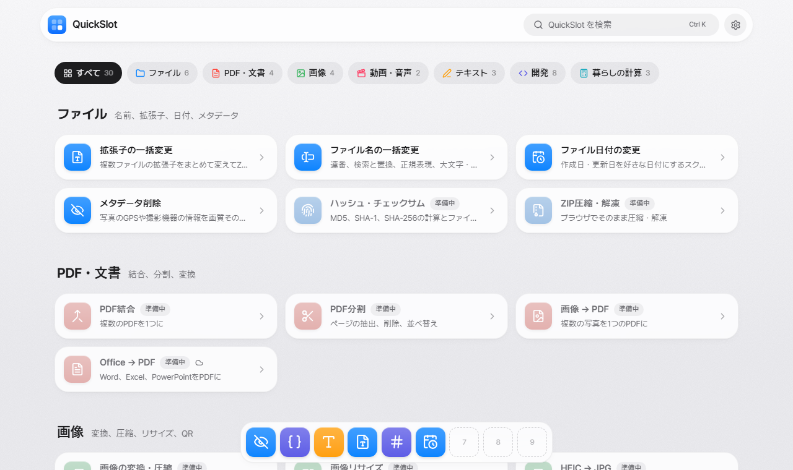

<div align="center">


# QuickSlot

**必要なツールを、ブラウザですぐに。**

すべてあなたの端末の中で動く、日常・開発ツール集。<br />
インストールも登録も不要で、ファイルがパソコンの外に出ることはありません。

[](https://github.com/wollu-dev/quick-slot/actions/workflows/ci.yml)
[](LICENSE)


[English](README.md) · [한국어](README.ko.md) · **日本語**

<picture>
  <source media="(prefers-color-scheme: dark)" srcset="docs/assets/home-ja-dark.png" />
  
</picture>

</div>

## なぜ QuickSlot？

ファイル名をまとめて変える、写真からGPS情報を消す、JSONを整形する。そんな小さな作業のために、怪しいサイトを探して他人のサーバーにファイルをアップロードしていませんか。

- **🔒 プライバシー重視の設計**：すべてのツールがブラウザ内で動作します。ファイルは端末内で処理され、どこにもアップロードされません。
- **⚡ すぐ使える**：インストールも登録も不要。ツールを開いてファイルをドロップするだけ。
- **⭐ クイックスロット**：よく使うツールを macOS 風のドックに最大9個まで固定し、<kbd>Alt</kbd>+<kbd>1</kbd>–<kbd>9</kbd> ですぐに開けます。
- **🌏 多言語**：韓国語・英語・日本語に対応、ライト・ダーク・自動の外観モード。

## ツール

| ツール | できること |
|---|---|
| **ファイル形式の変換** | 画像・音声・動画・データファイルを実際に変換（JPG、PNG、WebP、AVIF、HEIC、MP3、MP4、WebM、JSON、YAML、CSV、XML など） |
| **ファイル名の一括変更** | 連番、検索と置換、正規表現、大文字・小文字変換 |
| **ファイル日付の変更** | 作成日・更新日を変えたファイルをZIPで保存、または PowerShell / Bash スクリプトで適用 |
| **メタデータ削除** | JPEG / PNG / WebP のGPSや撮影機器の情報を画質そのままで削除 |
| **文字数カウント** | 空白あり・なし、単語、バイト数、原稿用紙の枚数 |
| **JSONフォーマッター** | 整形、圧縮、エラーの行・文字位置を表示 |
| **Base64 エンコード・デコード** | テキストとファイル、URLセーフ・data URL 形式 |
| **UNIXタイムスタンプ** | タイムスタンプ ↔ 日付の変換、単位を自動判定 |
| **UUID生成** | UUID v4 / v7 をまとめて生成 |

<details>
<summary><b>準備中</b>（20個）</summary>

| カテゴリ | ツール |
|---|---|
| ファイル | ハッシュ・チェックサム · ZIP圧縮・解凍 |
| PDF・文書 | PDF結合 · PDF分割 · 画像 → PDF · Office → PDF |
| 画像 | 画像圧縮 · 画像リサイズ · QRコード |
| 動画・音声 | 動画 → GIF · 画面録画 |
| テキスト | テキスト比較 · 韓英キー入力の変換 |
| 開発 | パスワード生成 · JWTデコーダー · カラー変換 · ノーマルマップG反転 |
| 暮らしの計算 | 日付計算 · 単位変換 · 割り勘計算 |

</details>

## 機能

- **Spotlight のような検索**：<kbd>Ctrl</kbd>+<kbd>K</kbd>（または <kbd>/</kbd>）でツールを検索。他の言語のツール名でも見つかります。
- **クイックスロットのドック**：位置は下・左・右、サイズは3段階から選べます。使用中のツールは、起動中のアプリのようにドットで表示されます。
- **設定シート**：外観モード、ドックの位置・サイズ、言語をひとまとめに。画面を描く前に適用されるので、ちらつきません。
- **言語の提案**：ブラウザの言語がページと違う場合、自動で移動させずに切り替えを提案します。そのため、すべての言語のページが検索エンジンに収集されます。
- **安全なファイル変換**：本当の形式は拡張子ではなくファイルの中身から判定します。形式が同じなら再圧縮せずに名前だけを変え、変換できない組み合わせは、拡張子と中身が食い違うファイルを作らずに拒否します。音声・動画には ffmpeg.wasm（約30MB、初回だけダウンロード）を使います。
- **必要なところは無劣化**：メタデータ削除は再圧縮せずにバイトを直接書き換え、オフにしない限り回転情報とカラープロファイルは残します。

## はじめかた

**必要なもの:** Node.js 22.23 以上と npm。

```bash
git clone https://github.com/wollu-dev/quick-slot.git
cd quick-slot
npm install
npm run dev
```

<http://localhost:4321> を開いてください。

| コマンド | 説明 |
|---|---|
| `npm run dev` | 開発サーバーを起動（`localhost:4321`） |
| `npm run build` | 静的サイトを `apps/web/dist` にビルド |
| `npm run preview` | ビルド結果をローカルで表示 |
| `npm run check` | プロジェクト全体の型チェック |

## 設定

サイトのURLはコードに書きません。ビルドする場所で指定します。

| 変数 | 用途 | 未設定の場合 |
|---|---|---|
| `SITE_URL` | サイトの完全なURL（例: `https://example.com`）。`hreflang`・`canonical` リンクに使用 | 相対URLで代用（開発には十分） |

- **ローカル:** `apps/web/.env.example` を `apps/web/.env` にコピー（git には含まれません）
- **GitHub Actions:** リポジトリの **Variables** に `SITE_URL` を追加
- **Docker:** `--build-arg SITE_URL=https://…`

## プロジェクト構成

```
quick-slot/
├─ apps/web/                 # ウェブサイト（Astro + React islands + Tailwind CSS）
│  ├─ src/
│  │  ├─ tools/registry.ts   # ★ ツール一覧（ホーム・検索・ドックはすべてここを参照）
│  │  ├─ tools/<カテゴリ>/   # ツールごとに React コンポーネントを1つ
│  │  ├─ i18n/               # 辞書: ko.ts（型の基準）、en.ts、ja.ts
│  │  ├─ views/              # すべての言語で共有するページテンプレート
│  │  ├─ pages/              # ルート: 韓国語は /…、英語・日本語は /[lang]/…
│  │  ├─ components/         # 検索、設定シート、ドック、共通UI
│  │  ├─ lib/                # ファイル・ZIP、メタデータ削除、スロット、テーマ、ドック設定
│  │  └─ styles/global.css   # デザイントークンとガラスのデザインシステム
│  └─ public/
├─ docs/assets/              # README 用スクリーンショット
└─ AGENTS.md                 # 人とAIエージェントのための貢献ルール
```

## ツールの追加

1. `apps/web/src/tools/registry.ts` に項目を追加
2. `apps/web/src/i18n/ko.ts`、`en.ts`、`ja.ts` の `tools` に名前と説明を追加（キーが欠けると型エラー）
   `status: 'soon'` ならここまでです。3言語の「準備中」ページが自動で作られます。
3. `apps/web/src/tools/<カテゴリ>/MyTool.tsx` にコンポーネントを作成
   UIの文言はすべて辞書に入れて `useT()` で読み、`export default withI18n(MyTool)` でエクスポートします。
4. `apps/web/src/views/ToolPage.astro` の「Tool component wiring」ブロックに接続:
   ```astro
   {slug === 'my-tool' && <MyTool client:load lang={lang} />}
   ```
   最初の表示が現在時刻・乱数・ブラウザの情報に依存する場合は `client:only="react"` を使います。
5. ツールの `status` を `'ready'` に変更

## 多言語対応

| 言語 | URL |
|---|---|
| 한국어（韓国語） | `/` |
| English（英語） | `/en/` |
| 日本語 | `/ja/` |

言語ごとに別々の静的ページを生成し、`hreflang` リンクでつなぎます。ブラウザの言語による自動リダイレクトはしません。そうすると、主に英語でアクセスする検索エンジンのクローラーが韓国語・日本語のページを見られなくなるためです。代わりに提案バナーを表示し、ユーザーが言語を選んだ後にだけ移動します。

## デプロイ

Docker イメージを GitHub Container Registry に公開し、セルフホストする予定です。まだ構築しておらず、現在は CI がすべてのプルリクエストの型チェックとビルドだけを行います。

## コントリビュート

コントリビュート歓迎です！GitHub Flow に従います: `main` からブランチを作り、プルリクエストを開き、CI が通ったら squash merge します。

まず **[AGENTS.ja.md](AGENTS.ja.md)** をお読みください。コード・デザイン・多言語・コミット・プルリクエストのルールがあり、人にもAIコーディングエージェントにも適用されます。（原文: [AGENTS.md](AGENTS.md)、英語）

## ライセンス

[MIT](LICENSE) © 2026 Jaeyun Jung (WolLu)
