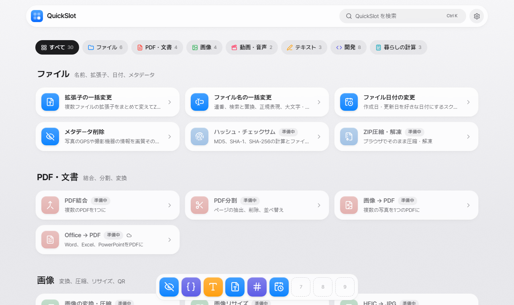

<div align="center">


# QuickSlot

**必要なツールを、ブラウザですぐに。**

あなたの端末の中で動く、日常・開発ツール集。<br />
インストールも登録も不要で、特に表示のあるツールを除き、ファイルがパソコンの外に出ることはありません。

[](https://github.com/wollu-dev/quick-slot/actions/workflows/ci.yml)
[](LICENSE.md)


[English](README.md) · [한국어](README.ko.md) · **日本語**

<picture>
  <source media="(prefers-color-scheme: dark)" srcset="docs/assets/home-ja-dark.png" />
  
</picture>

</div>

## なぜ QuickSlot？

ファイル名をまとめて変える、写真からGPS情報を消す、JSONを整形する。そんな小さな作業のために、怪しいサイトを探して他人のサーバーにファイルをアップロードしていませんか。

- **🔒 プライバシー重視の設計**：ツールは基本的にブラウザ内で動作し、ファイルは端末内で処理されます。サーバーが必要な一部のツールはその旨を表示し、送信されたファイルは処理後すぐに削除します。
- **⚡ すぐ使える**：インストールも登録も不要。ツールを開いてファイルをドロップするだけ。
- **⭐ クイックスロット**：よく使うツールを macOS 風のドックに最大9個まで固定し、<kbd>Alt</kbd>+<kbd>1</kbd>–<kbd>9</kbd> ですぐに開けます。
- **🔗 マイツール**：よく使うWebサイト（例: AIチャット）をツールとして追加できます。検索やドックにも表示され、アップロード・ライセンス・個人情報についての短い案内のあと新しいタブで開きます。
- **🌏 多言語**：韓国語・英語・日本語に対応、ライト・ダーク・自動の外観モード。

## ツール

| ツール | できること |
|---|---|
| **ファイル形式の変換** | 画像・音声・動画・データファイルを実際に変換（JPG、PNG、WebP、AVIF、HEIC、MP3、MP4、WebM、JSON、YAML、CSV、XML など） |
| **濁点・ハングル分離の修正** | Mac から来たファイル名の濁点やハングルの分離を NFC で修正、フォルダで直接・ZIP で保存・テキスト変換 |
| **ファイル一括整理** | 複数のファイルを変換・メタデータ削除・名前変更・分離の修正・日付指定・SHA-256 一覧まで一度に処理し、フォルダ構成のまま ZIP に |
| **ファイル名の一括変更** | 連番、検索と置換、正規表現、大文字・小文字変換 |
| **ファイル日付の変更** | 作成日・更新日を変えたファイルをZIPで保存、または PowerShell / Bash スクリプトで適用 |
| **PDF結合** | 複数の PDF を好きな順番で結合、ファイルごとに必要なページだけ選択（例: 1-3, 5, 8-） |
| **PDF分割** | サムネイルを見ながらページの選択・削除・回転・並べ替えをして保存、選択ページの抽出、N ページごとや範囲で分割 |
| **画像 → PDF** | A4・Letter・A5 または画像サイズのページに1枚ずつ、向きと余白を指定、JPEG・PNG は再圧縮せずそのまま |
| **動画 → GIF** | 好きな区間を切り出してアニメーション GIF に、幅・フレームレート・速度・画質を指定 |
| **画面録画** | 画面・ウィンドウ・タブを画面の音やマイクと一緒に録画、一時停止・再開、MP4 または WebM で保存 |
| **動画ダウンローダー**（サーバー使用） | 動画ページのアドレスから MP4 または MP3・M4A で保存（API で yt-dlp を使用、送った直後に削除）。権利のある動画のみ |
| **メタデータの削除・編集** | JPEG / PNG / WebP のGPSや撮影機器の情報を画質そのままで削除、JPEG の撮影日時（指定、または複数枚まとめて時刻をずらす）・位置・作成者・著作権・タイトルを編集 |
| **ハッシュ・チェックサム** | ファイルや文章の MD5・SHA-1・SHA-256・SHA-512・CRC32 を計算、公開されたハッシュ値の検証、ファイル内容の比較 |
| **ZIP圧縮・解凍** | ファイルやフォルダを UTF-8 の名前で圧縮、ZIP の中身を見て1つだけ保存またはフォルダにまとめて解凍、文字化けした韓国語・日本語の名前を修復 |
| **画像圧縮** | MozJPEG・OxiPNG・WebP・AVIF エンコーダーで JPEG・PNG・WebP・AVIF・HEIC を軽量化、圧縮前後の比較 |
| **画像リサイズ** | ピクセル・割合・長辺を基準に複数の画像をまとめてサイズ変更、指定サイズに切り抜き（位置を指定） |
| **QRコード** | リンク・テキスト・Wi-Fi・連絡先・メール・電話・SMS の QR を作成（PNG・SVG、色指定）、画像やカメラで読み取り |
| **文字数カウント** | 空白あり・なし、単語、バイト数、原稿用紙の枚数 |
| **韓英キー入力の変換** | 韓/英モードを間違えて打った文字を直す（dkssud → 안녕、ㅗ디ㅣㅐ → hello） |
| **テキスト比較** | 2つの文章を行・単語・文字単位で比較し、変わった単語を強調、diff でコピー |
| **JSONフォーマッター** | 整形、圧縮、エラーの行・文字位置を表示 |
| **Base64 エンコード・デコード** | テキストとファイル、URLセーフ・data URL 形式 |
| **UNIXタイムスタンプ** | タイムスタンプ ↔ 日付の変換、単位を自動判定 |
| **UUID生成** | UUID v4 / v7 をまとめて生成 |
| **パスワード生成** | 長さと文字の種類を選んで作るランダムパスワード、強度表示つき |
| **JWTデコーダー** | トークンのヘッダー・ペイロードと有効期限の状態、読みやすい日時を表示（署名は検証しない） |
| **カラー変換** | 色を選ぶか貼り付けると HEX、RGB、HSL、Unity、Unreal（Linear）、Godot のコードでコピー、WCAG コントラストも確認 |
| **進数変換** | 2・8・10・16進数と 2〜36進数を同時に、どんなに大きな数も正確に、8〜64ビットの2の補数とビットのクリック編集 |
| **ノーマルマップG反転** | DirectX ↔ OpenGL のノーマルマップを値そのままで変換（8・16ビット PNG、TGA、アルファ保持）、ライティングのプレビューと _DX / _GL のリネーム |
| **日付計算** | 2つの日付の間の日数（D-day、平日数）、満年齢と干支、日・週・月・平日の加算・減算 |
| **単位変換** | 長さ、重さ、面積（坪を含む）、体積、温度、速さ、データ量をすべての単位で一度に |
| **サーバー時刻確認**（サーバー使用） | サイトのサーバー時計を0.01秒単位で（Date ヘッダーを API が代わりに取得）、チケット予約・履修登録用のカウントダウンと音の通知 |
| **抽選ゲーム** | ルーレット・あみだくじ・ピンボールで公平に抽選（ブラウザの暗号学的乱数を使用） |
| **割り勘計算** | 均等に、または人ごとの追加金額を入れて分け、10・100円単位にそろえて精算内容をコピー |

<details>
<summary><b>準備中</b>（1個）</summary>

| カテゴリ | ツール |
|---|---|
| PDF・文書 | Office → PDF |

</details>

## 機能

- **Spotlight のような検索**：<kbd>Ctrl</kbd>+<kbd>K</kbd>（または <kbd>/</kbd>）でツールを検索。他の言語のツール名でも見つかります。
- **クイックスロットのドック**：位置は下・左・右、サイズは3段階から選べます。使用中のツールは、起動中のアプリのようにドットで表示されます。
- **設定シート**：外観モード、ドックの位置・サイズ、言語をひとまとめに。画面を描く前に適用されるので、ちらつきません。
- **言語の提案**：ブラウザの言語がページと違う場合、自動で移動させずに切り替えを提案します。そのため、すべての言語のページが検索エンジンに収集されます。
- **安全なファイル変換**：本当の形式は拡張子ではなくファイルの中身から判定します。形式が同じなら再圧縮せずに名前だけを変え、変換できない組み合わせは、拡張子と中身が食い違うファイルを作らずに拒否します。音声・動画には ffmpeg.wasm（約30MB、初回だけダウンロード）を使います。
- **必要なところは無劣化**：メタデータ削除は再圧縮せずにバイトを直接書き換え、オフにしない限り回転情報とカラープロファイルは残します。

## はじめかた

**必要なもの:** Node.js 22.23 以上と npm。

```bash
git clone https://github.com/wollu-dev/quick-slot.git
cd quick-slot
npm install
npm run dev
```

<http://localhost:4321> を開いてください。

| コマンド | 説明 |
|---|---|
| `npm run dev` | 開発サーバーを起動（`localhost:4321`） |
| `npm run build` | 静的サイトを `apps/web/dist` にビルド |
| `npm run preview` | ビルド結果をローカルで表示 |
| `npm run dev:api` | API サーバーを `localhost:8787` で起動（サーバーツールにだけ必要。開発サーバーが `/api` を転送） |
| `npm test` | API のテストを実行 |
| `npm run check` | プロジェクト全体の型チェック |

## 設定

サイトのURLはコードに書きません。ビルドする場所で指定します。

| 変数 | 用途 | 未設定の場合 |
|---|---|---|
| `SITE_URL` | サイトの完全なURL（例: `https://example.com`）。`hreflang`・`canonical` リンクに使用 | 相対URLで代用（開発には十分） |

- **ローカル:** `apps/web/.env.example` を `apps/web/.env` にコピー（git には含まれません）
- **GitHub Actions:** リポジトリの **Variables** に `SITE_URL` を追加
- **Docker:** `--build-arg SITE_URL=https://…`

API（`apps/api`、`apps/api/.env.example` を参照）の設定:

| 変数 | 用途 | 既定値 |
|---|---|---|
| `PORT` | API が待ち受けるポート | `8787` |
| `TRUST_PROXY` | クライアントのアドレスを `X-Forwarded-For` から読む（同梱の nginx の背後では `true`） | `false` |
| `RATE_LIMIT_PER_MINUTE` | クライアントのアドレスごとの1分あたりの許可リクエスト数 | `60` |
| `LOG_REQUESTS` | リクエストごとに1行記録: メソッド、クエリを除いたパス、ステータス、時間 | `true` |
| `SERVER_TIME_PER_MINUTE` | クライアントのアドレスごとの1分あたりのサーバー時刻確認回数（1回でサイトに約20回リクエスト） | `6` |
| `VIDEO_MAX_MB` | 動画ダウンローダーが作るファイルの最大サイズ（MB） | `1024` |
| `VIDEO_MAX_MINUTES` | 受け付ける動画の最大の長さ（分） | `120` |
| `VIDEO_CONCURRENT` | サーバーで同時に行う動画ダウンロード数 | `2` |
| `VIDEO_PER_HOUR` | クライアントのアドレスごとの1時間あたりの動画ダウンロード回数 | `10` |
| `VIDEO_WORK_DIR` | 送るまでファイルを置くフォルダー（送った直後に削除） | システムの一時フォルダー、イメージでは `/work` |
| `YTDLP_PATH` | yt-dlp コマンド | `yt-dlp` |
| `SITE_URL` | サイトの公開アドレス（Web ビルドと同じ値）。ログインリンクはこのアドレスを指す | `http://localhost:4321` |
| `DATABASE_URL` | アカウント機能をオンにする: `postgres://…`、またはローカル開発用の `pglite:.data/db` | アカウントはオフ |
| `AUTH_SECRET` | セッション Cookie に署名する長いランダムな文字列（本番では `DATABASE_URL` と併せて必須） | 起動ごとにランダム（開発） |
| `SMTP_URL`、`MAIL_FROM` | ログインメールを送る SMTP サーバーと差出人 | リンクをコンソールに表示（開発のみ） |
| `GOOGLE_CLIENT_ID`、`GOOGLE_CLIENT_SECRET` | Google でログイン | オフ |
| `APPLE_CLIENT_ID`、`APPLE_CLIENT_SECRET` | Apple でログイン | オフ |

## プロジェクト構成

```
quick-slot/
├─ apps/api/                 # 一部のサーバーツール用 API（Node 24 上の Hono）
├─ apps/web/                 # ウェブサイト（Astro + React islands + Tailwind CSS）
│  ├─ src/
│  │  ├─ tools/registry.ts   # ★ ツール一覧（ホーム・検索・ドックはすべてここを参照）
│  │  ├─ tools/<カテゴリ>/   # ツールごとに React コンポーネントを1つ
│  │  ├─ i18n/               # 辞書: ko.ts（型の基準）、en.ts、ja.ts
│  │  ├─ views/              # すべての言語で共有するページテンプレート
│  │  ├─ pages/              # ルート: 韓国語は /…、英語・日本語は /[lang]/…
│  │  ├─ components/         # 検索、設定シート、ドック、共通UI
│  │  ├─ lib/                # ファイル・ZIP、メタデータ削除、スロット、テーマ、ドック設定
│  │  └─ styles/global.css   # デザイントークンとガラスのデザインシステム
│  └─ public/
├─ deploy/nginx.conf         # web イメージの nginx 設定
├─ Dockerfile                # イメージ: web（nginx + 静的サイト）、api
├─ docker-compose.yml        # web と api を一緒に起動
├─ docs/assets/              # README 用スクリーンショット
└─ AGENTS.md                 # 人とAIエージェントのための貢献ルール
```

## ツールの追加

1. `apps/web/src/tools/registry.ts` に項目を追加
2. `apps/web/src/i18n/ko.ts`、`en.ts`、`ja.ts` の `tools` に名前と説明を追加（キーが欠けると型エラー）
   `status: 'soon'` ならここまでです。3言語の「準備中」ページが自動で作られます。
3. `apps/web/src/tools/<カテゴリ>/MyTool.tsx` にコンポーネントを作成
   UIの文言はすべて辞書に入れて `useT()` で読み、`export default withI18n(MyTool)` でエクスポートします。
4. `apps/web/src/views/ToolPage.astro` の「Tool component wiring」ブロックに接続:
   ```astro
   {slug === 'my-tool' && <MyTool client:load lang={lang} />}
   ```
   最初の表示が現在時刻・乱数・ブラウザの情報に依存する場合は `client:only="react"` を使います。
5. ツールの `status` を `'ready'` に変更

## 多言語対応

| 言語 | URL |
|---|---|
| 한국어（韓国語） | `/` |
| English（英語） | `/en/` |
| 日本語 | `/ja/` |

言語ごとに別々の静的ページを生成し、`hreflang` リンクでつなぎます。ブラウザの言語による自動リダイレクトはしません。そうすると、主に英語でアクセスする検索エンジンのクローラーが韓国語・日本語のページを見られなくなるためです。代わりに提案バナーを表示し、ユーザーが言語を選んだ後にだけ移動します。

## デプロイ

QuickSlot は Docker でセルフホストします。ルートの `Dockerfile` が2つのイメージを作ります: **web**（静的サイトを配信し `/api` を API に渡す nginx）と **api**。CI はプルリクエストごとに両方をビルドし、一緒に動くか確認します。

```bash
SITE_URL=https://example.com docker compose build
docker compose up -d          # http://localhost:8080（QUICKSLOT_PORT で変更）
```

ポートを公開するのは web コンテナだけで、API には nginx を通してだけアクセスします。バージョンタグ（`v*`）で GitHub Container Registry にイメージを公開する仕組みは今後追加する予定です。

**アカウント（任意、Pro 機能用）。** 無料ツールはすべてアカウントなしで動作します。オンにするには、`accounts` プロファイルで同梱の Postgres を起動し、API にデータベース・シークレット・サイトのアドレスを渡します:

```bash
COMPOSE_PROFILES=accounts POSTGRES_PASSWORD=… AUTH_SECRET=$(openssl rand -base64 32) \
SITE_URL=https://example.com DATABASE_URL=postgres://quickslot:…@db:5432/quickslot \
SMTP_URL=smtps://… docker compose up -d
```

API は起動時にテーブルを作成します。ローカル開発では `apps/api/.env` に `DATABASE_URL=pglite:.data/db` と書けば Postgres なしで動作し、ログインリンクはコンソールに表示されます。

## コントリビュート

コントリビュート歓迎です！変更の送り方は **[CONTRIBUTING.ja.md](CONTRIBUTING.ja.md)** をご覧ください。GitHub Flow に従います: `main` からブランチを作り、プルリクエストを開き、CI が通ったら squash merge します。最初のプルリクエストで[コントリビューターライセンス契約（CLA）](CLA.md)への署名をお願いします。著作権はコントリビューターに残ります。

まず **[AGENTS.ja.md](AGENTS.ja.md)** をお読みください。コード・デザイン・多言語・コミット・プルリクエストのルールがあり、人にもAIコーディングエージェントにも適用されます。（原文: [AGENTS.md](AGENTS.md)、英語）

## ライセンス

QuickSlot は n8n と同じ「フェアコード（fair-code）」方式で、ソースを公開した [Sustainable Use License](LICENSE.md) に従います。

- **できること:** 個人的・非商用の目的や自社の社内業務のために使用、改変、セルフホストすること、非商用の目的で無料で共有すること。
- **できないこと:** 販売すること、他者に有料・商用サービスとして提供すること。
- 名前に `.ee.` を含むファイルと `ee/` フォルダーのファイル（有料機能）は [QuickSlot Enterprise License](LICENSE_EE.md) に従います。本番利用には QuickSlot のサブスクリプションか Enterprise ライセンスが必要で、開発・テストは無料です。
- コミット `7ee6d28`（2026年11月17日）までのバージョンは MIT ライセンスで公開されており、引き続き MIT で利用できます。
- サードパーティのコンポーネントはそれぞれのライセンスに従います（例: ffmpeg.wasm は GPL-2.0-or-later）。

商用ライセンスは [Issue](https://github.com/wollu-dev/quick-slot/issues) でお問い合わせください。

© 2026 Jaeyun Jung (WolLu)
