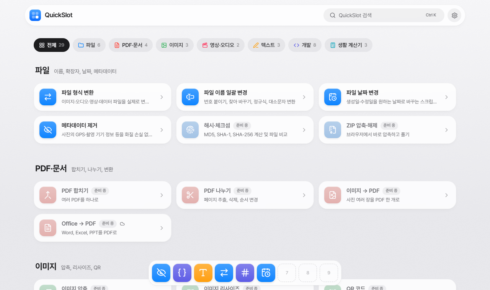

<div align="center">


# QuickSlot

**필요한 도구, 브라우저에서 바로 꺼내 쓰세요.**

내 기기 안에서만 동작하는 생활·개발 도구 모음.<br />
설치도, 가입도 없고, 파일은 내 컴퓨터를 떠나지 않습니다.

[](https://github.com/wollu-dev/quick-slot/actions/workflows/ci.yml)
[](LICENSE)


[English](README.md) · **한국어** · [日本語](README.ja.md)

<picture>
  <source media="(prefers-color-scheme: dark)" srcset="docs/assets/home-ko-dark.png" />
  
</picture>

</div>

## 왜 QuickSlot인가요?

파일 이름 여러 개 바꾸기, 사진에서 GPS 정보 지우기, JSON 정리하기. 이런 작은 일 때문에 수상한 사이트를 찾아 다른 사람의 서버에 파일을 올리곤 합니다.

- **🔒 처음부터 개인정보 보호**: 모든 툴이 브라우저 안에서 동작합니다. 파일은 내 기기에서 처리되고 어디에도 올라가지 않습니다.
- **⚡ 바로 사용**: 설치도 가입도 없습니다. 툴을 열고 파일을 끌어다 놓으면 끝.
- **⭐ 퀵슬롯**: 자주 쓰는 툴을 macOS 같은 독에 최대 9개까지 고정하고 <kbd>Alt</kbd>+<kbd>1</kbd>–<kbd>9</kbd>로 바로 엽니다.
- **🌏 다국어**: 한국어·영어·일본어, 라이트·다크·자동 화면 모드.

## 툴

| 툴 | 하는 일 |
|---|---|
| **확장자 일괄 변경** | 여러 파일의 확장자를 한 번에 바꿔서 ZIP으로 받기 |
| **파일 이름 일괄 변경** | 번호 붙이기, 찾아 바꾸기, 정규식, 대소문자 변환 |
| **파일 날짜 변경** | 생성일·수정일을 바꾸는 PowerShell / Bash 스크립트 생성 |
| **메타데이터 제거** | JPEG / PNG / WebP 의 GPS·촬영 기기 정보 등을 화질 손실 없이 제거 |
| **글자 수 세기** | 공백 포함·제외, 단어, 바이트, 원고지 매수 |
| **JSON 포매터** | 정렬, 압축, 오류가 난 줄·칸 표시 |
| **Base64 인코딩·디코딩** | 텍스트와 파일, URL-safe·data URL 형식 |
| **유닉스 타임스탬프** | 타임스탬프 ↔ 날짜 변환, 단위 자동 감지 |
| **UUID 생성기** | UUID v4 / v7 대량 생성 |

<details>
<summary><b>준비 중</b> (21개)</summary>

| 분류 | 툴 |
|---|---|
| 파일 | 해시·체크섬 · ZIP 압축·해제 |
| PDF·문서 | PDF 합치기 · PDF 나누기 · 이미지 → PDF · Office → PDF |
| 이미지 | 이미지 변환·압축 · 이미지 리사이즈 · HEIC → JPG · QR 코드 |
| 영상·오디오 | 영상 → GIF · 화면 녹화 |
| 텍스트 | 텍스트 비교 · 한영 타자 변환 |
| 개발 | 비밀번호 생성기 · JWT 디코더 · 색상 변환기 · 노멀맵 G채널 반전 |
| 생활 계산기 | 날짜 계산기 · 단위 변환 · 더치페이 계산 |

</details>

## 기능

- **스포트라이트 같은 검색**: <kbd>Ctrl</kbd>+<kbd>K</kbd>(또는 <kbd>/</kbd>)로 툴을 찾습니다. 다른 언어의 툴 이름으로도 찾을 수 있어요.
- **퀵슬롯 독**: 아래·왼쪽·오른쪽 중 위치를, 세 가지 중 크기를 고릅니다. 지금 쓰는 툴은 실행 중인 앱처럼 점으로 표시됩니다.
- **설정 시트**: 화면 모드, 독 위치·크기, 언어를 한곳에서. 화면을 그리기 전에 적용되어 깜빡임이 없습니다.
- **언어 제안**: 브라우저 언어가 페이지와 다르면 자동으로 이동시키지 않고 바꾸기를 제안합니다. 그래서 모든 언어 페이지가 검색엔진에 수집됩니다.
- **필요한 곳은 무손실**: 메타데이터 제거는 다시 압축하지 않고 바이트를 직접 고치며, 따로 끄지 않으면 회전 정보와 색상 프로필은 남깁니다.

## 시작하기

**필요한 것:** Node.js 22.23 이상, npm.

```bash
git clone https://github.com/wollu-dev/quick-slot.git
cd quick-slot
npm install
npm run dev
```

<http://localhost:4321> 을 열면 됩니다.

| 명령 | 설명 |
|---|---|
| `npm run dev` | 개발 서버 실행 (`localhost:4321`) |
| `npm run build` | 정적 사이트를 `apps/web/dist` 로 빌드 |
| `npm run preview` | 빌드 결과를 로컬에서 띄워 보기 |
| `npm run check` | 프로젝트 전체 타입 검사 |

## 설정

사이트 주소는 코드에 쓰지 않습니다. 빌드하는 곳에서 넣습니다.

| 변수 | 용도 | 없으면 |
|---|---|---|
| `SITE_URL` | 사이트 전체 주소 (예: `https://example.com`). `hreflang`·`canonical` 링크에 사용 | 상대 주소로 대신 (개발용으로는 충분) |

- **내 PC:** `apps/web/.env.example` 을 `apps/web/.env` 로 복사 (git 에 안 올라감)
- **GitHub Actions:** 저장소 **Variables** 에 `SITE_URL` 추가
- **Docker:** `--build-arg SITE_URL=https://…`

## 프로젝트 구조

```
quick-slot/
├─ apps/web/                 # 웹사이트 (Astro + React islands + Tailwind CSS)
│  ├─ src/
│  │  ├─ tools/registry.ts   # ★ 툴 목록 (홈·검색·독이 모두 여기서 읽음)
│  │  ├─ tools/<분류>/       # 툴마다 React 컴포넌트 하나
│  │  ├─ i18n/               # 사전: ko.ts (타입 기준), en.ts, ja.ts
│  │  ├─ views/              # 모든 언어가 같이 쓰는 페이지 템플릿
│  │  ├─ pages/              # 주소: 한국어 /…, 영어·일본어 /[lang]/…
│  │  ├─ components/         # 검색, 설정 시트, 독, 공용 UI
│  │  ├─ lib/                # 파일·ZIP, 메타데이터 제거, 슬롯, 테마, 독 설정
│  │  └─ styles/global.css   # 디자인 토큰과 글래스 디자인 시스템
│  └─ public/
├─ docs/assets/              # README 스크린샷
└─ AGENTS.md                 # 사람과 AI 에이전트를 위한 기여 규칙
```

## 툴 추가하기

1. `apps/web/src/tools/registry.ts` 에 항목 추가
2. `apps/web/src/i18n/ko.ts`, `en.ts`, `ja.ts` 의 `tools` 에 이름·설명 추가 (키가 빠지면 타입 오류)
   `status: 'soon'` 이면 여기서 끝입니다. 세 언어로 "준비 중" 페이지가 자동 생성됩니다.
3. `apps/web/src/tools/<분류>/MyTool.tsx` 컴포넌트 작성
   UI 문구는 모두 사전에 넣고 `useT()` 로 읽고, `export default withI18n(MyTool)` 로 내보냅니다.
4. `apps/web/src/views/ToolPage.astro` 의 "Tool component wiring" 블록에 연결:
   ```astro
   {slug === 'my-tool' && <MyTool client:load lang={lang} />}
   ```
   첫 화면이 현재 시각·랜덤 값·브라우저 정보에 따라 달라지면 `client:only="react"` 를 씁니다.
5. 툴의 `status` 를 `'ready'` 로 변경

## 다국어

| 언어 | 주소 |
|---|---|
| 한국어 | `/` |
| English | `/en/` |
| 日本語 | `/ja/` |

언어마다 정적 페이지가 따로 만들어지고 `hreflang` 링크로 연결됩니다. 브라우저 언어로 자동 이동시키지 않습니다. 그러면 대부분 영어로 접속하는 검색엔진 로봇이 한국어·일본어 페이지를 보지 못합니다. 대신 제안 배너를 띄우고, 사용자가 언어를 직접 고른 뒤에만 이동합니다.

## 배포

Docker 이미지를 GitHub Container Registry 에 올려 직접 호스팅할 계획입니다. 아직 만들지 않았고, 지금은 CI 가 모든 PR 의 타입 검사와 빌드만 합니다.

## 기여하기

기여를 환영합니다! GitHub Flow 를 따릅니다: `main` 에서 브랜치를 만들고, PR 을 열고, CI 가 통과하면 squash merge 합니다.

먼저 **[AGENTS.ko.md](AGENTS.ko.md)** 를 읽어 주세요. 코드·디자인·다국어·커밋·PR 규칙이 있고, 사람과 AI 코딩 에이전트 모두에게 적용됩니다. (원본: [AGENTS.md](AGENTS.md), 영어)

## 라이선스

[MIT](LICENSE) © 2026 WolLu
