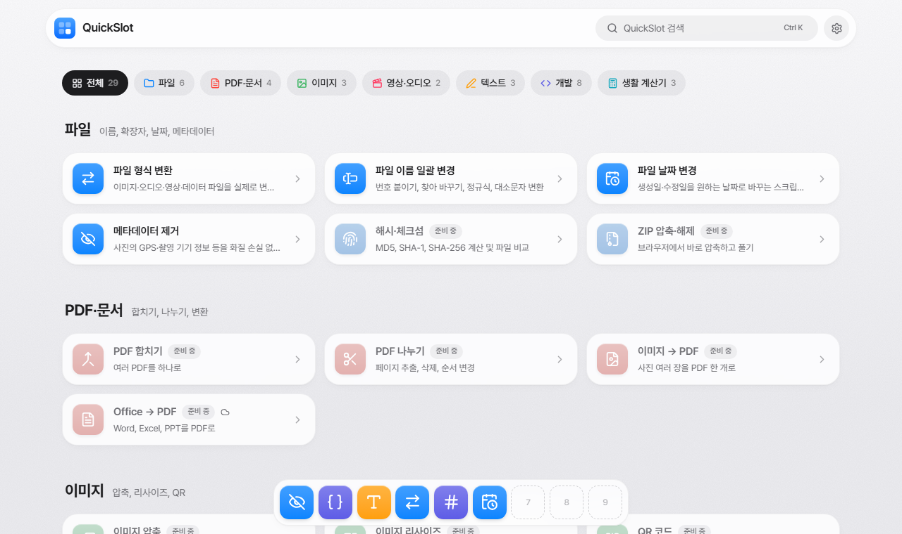

<div align="center">


# QuickSlot

**필요한 도구, 브라우저에서 바로 꺼내 쓰세요.**

내 기기 안에서 동작하는 생활·개발 도구 모음.<br />
설치도, 가입도 없고, 따로 표시된 도구가 아니면 파일은 내 컴퓨터를 떠나지 않습니다.

[](https://github.com/wollu-dev/quick-slot/actions/workflows/ci.yml)
[](LICENSE.md)


[English](README.md) · **한국어** · [日本語](README.ja.md)

<picture>
  <source media="(prefers-color-scheme: dark)" srcset="docs/assets/home-ko-dark.png" />
  
</picture>

</div>

## 왜 QuickSlot인가요?

파일 이름 여러 개 바꾸기, 사진에서 GPS 정보 지우기, JSON 정리하기. 이런 작은 일 때문에 수상한 사이트를 찾아 다른 사람의 서버에 파일을 올리곤 합니다.

- **🔒 처음부터 개인정보 보호**: 툴은 기본적으로 브라우저 안에서 동작해서, 파일이 내 기기에서 처리됩니다. 서버가 꼭 필요한 일부 툴은 따로 표시하고, 서버로 보낸 파일은 처리 직후 삭제합니다.
- **⚡ 바로 사용**: 설치도 가입도 없습니다. 툴을 열고 파일을 끌어다 놓으면 끝.
- **⭐ 퀵슬롯**: 자주 쓰는 툴을 macOS 같은 독에 최대 9개까지 고정하고 <kbd>Alt</kbd>+<kbd>1</kbd>–<kbd>9</kbd>로 바로 엽니다.
- **🔗 내 도구**: 자주 쓰는 웹사이트(예: AI 채팅)를 도구로 추가합니다. 검색과 독에 함께 나오고, 파일 업로드·라이선스·개인정보에 대한 짧은 안내를 거쳐 새 탭에서 열립니다.
- **🌏 다국어**: 한국어·영어·일본어, 라이트·다크·자동 화면 모드.

## 툴

| 툴 | 하는 일 |
|---|---|
| **파일 형식 변환** | 이미지·오디오·영상·데이터 파일을 실제로 변환 (JPG, PNG, WebP, AVIF, HEIC, MP3, MP4, WebM, JSON, YAML, CSV, XML 등) |
| **자모 분리 해결** | Mac에서 온 파일 이름이 ㅎㅏㄴㄱㅡㄹ처럼 보이는 문제를 NFC로 해결, 폴더에서 바로 고치기·ZIP 받기·텍스트 변환 |
| **파일 정제** | 여러 파일을 한 번에 변환·메타데이터 제거·이름 변경·자모 분리 정리·날짜 지정·SHA-256 목록까지 처리해 폴더 구조 그대로 ZIP으로 |
| **파일 이름 일괄 변경** | 번호 붙이기, 찾아 바꾸기, 정규식, 대소문자 변환 |
| **파일 날짜 변경** | 생성일·수정일을 바꾼 파일을 ZIP으로 받거나 PowerShell / Bash 스크립트로 적용 |
| **PDF 합치기** | 여러 PDF를 원하는 순서로 합치기, 파일마다 필요한 페이지만 고르기(예: 1-3, 5, 8-) |
| **PDF 나누기** | 썸네일을 보며 쪽 선택·삭제·회전·순서 변경 후 저장, 선택한 쪽만 추출, N쪽마다 또는 범위로 나누기 |
| **이미지 → PDF** | A4·Letter·A5 또는 이미지 크기 쪽에 한 장씩, 방향과 여백 지정, JPEG·PNG는 다시 압축하지 않고 그대로 넣기 |
| **영상 → GIF** | 원하는 구간을 잘라 움직이는 GIF로, 크기·프레임 수·속도·화질 지정 |
| **화면 녹화** | 화면·창·탭을 화면 소리, 마이크와 함께 녹화, 일시정지·계속, MP4나 WebM으로 저장 |
| **비디오 다운로더** (서버 사용) | 영상 페이지 주소로 MP4 또는 MP3·M4A 저장 (API에서 yt-dlp 사용, 보낸 즉시 삭제). 권리가 있는 영상만 |
| **메타데이터 제거·수정** | JPEG / PNG / WebP 의 GPS·촬영 기기 정보 등을 화질 손실 없이 제거, JPEG의 촬영 날짜(지정 또는 여러 장 한꺼번에 시간 이동)·위치·작성자·저작권·제목 수정 |
| **해시·체크섬** | 파일이나 글의 MD5·SHA-1·SHA-256·SHA-512·CRC32 계산, 받은 해시값 검증, 파일 내용 비교 |
| **ZIP 압축·해제** | 파일·폴더를 UTF-8 이름으로 압축, ZIP 내용을 보고 파일 하나만 받거나 폴더에 한꺼번에 풀기, 깨진 한글·일본어 이름 복구 |
| **이미지 압축** | MozJPEG·OxiPNG·WebP·AVIF 인코더로 JPEG·PNG·WebP·AVIF·HEIC 용량 줄이기, 압축 전후 비교 |
| **이미지 리사이즈** | 픽셀·비율·긴 변 기준으로 여러 장 한꺼번에 크기 변경, 원하는 크기로 잘라 채우기(자를 위치 지정) |
| **QR 코드** | 링크·텍스트·Wi-Fi·연락처·이메일·전화·문자 QR 만들기(PNG·SVG, 색상 지정), 이미지나 카메라로 읽기 |
| **글자 수 세기** | 공백 포함·제외, 단어, 바이트, 원고지 매수 |
| **한영 타자 변환** | 한/영 키를 잘못 두고 친 글 되돌리기 (dkssud → 안녕, ㅗ디ㅣㅐ → hello) |
| **텍스트 비교** | 두 글을 줄·단어·글자 단위로 비교하고 바뀐 단어 강조, diff로 복사 |
| **JSON 포매터** | 정렬, 압축, 오류가 난 줄·칸 표시 |
| **Base64 인코딩·디코딩** | 텍스트와 파일, URL-safe·data URL 형식 |
| **유닉스 타임스탬프** | 타임스탬프 ↔ 날짜 변환, 단위 자동 감지 |
| **UUID 생성기** | UUID v4 / v7 대량 생성 |
| **비밀번호 생성기** | 길이와 문자 종류를 골라 만드는 랜덤 비밀번호, 강도 표시 |
| **JWT 디코더** | 토큰의 헤더·페이로드와 만료 상태, 읽기 쉬운 시각 표시 (서명 검증은 안 함) |
| **색상 변환기** | 색을 고르거나 붙여 넣으면 HEX, RGB, HSL, Unity, Unreal(Linear), Godot 코드로 복사, WCAG 대비 확인 |
| **진수 변환기** | 2·8·10·16진수와 2~36진법을 한 번에, 아무리 큰 수도 정확하게, 8~64비트 2의 보수와 비트 클릭 편집 |
| **노멀맵 G채널 반전** | DirectX ↔ OpenGL 노멀맵을 값 그대로 변환(8·16비트 PNG, TGA, 알파 유지), 조명 미리보기와 _DX / _GL 이름 바꾸기 |
| **날짜 계산기** | 두 날짜 사이 일수(D-day, 평일 수), 만 나이와 띠, 날짜에 일·주·개월·평일 더하고 빼기 |
| **단위 변환** | 길이, 무게, 넓이(평 포함), 부피, 온도, 속도, 데이터 크기를 모든 단위로 한 번에 |
| **서버 시간 확인** (서버 사용) | 사이트의 서버 시계를 0.01초 단위로 (Date 헤더를 우리 API가 대신 조회), 수강신청·티켓팅용 카운트다운과 소리 알림 |
| **뽑기 게임** | 룰렛·사다리타기·핀볼로 공정하게 뽑기 (브라우저 암호학적 난수 사용) |
| **더치페이 계산** | 똑같이 또는 사람별 추가 금액을 넣어 나누고, 10·100·1000원 단위로 맞춘 뒤 정산 내용 복사 |

<details>
<summary><b>준비 중</b> (1개)</summary>

| 분류 | 툴 |
|---|---|
| PDF·문서 | Office → PDF |

</details>

## 기능

- **스포트라이트 같은 검색**: <kbd>Ctrl</kbd>+<kbd>K</kbd>(또는 <kbd>/</kbd>)로 툴을 찾습니다. 다른 언어의 툴 이름으로도 찾을 수 있어요.
- **퀵슬롯 독**: 아래·왼쪽·오른쪽 중 위치를, 세 가지 중 크기를 고릅니다. 지금 쓰는 툴은 실행 중인 앱처럼 점으로 표시됩니다.
- **설정 시트**: 화면 모드, 독 위치·크기, 언어를 한곳에서. 화면을 그리기 전에 적용되어 깜빡임이 없습니다.
- **언어 제안**: 브라우저 언어가 페이지와 다르면 자동으로 이동시키지 않고 바꾸기를 제안합니다. 그래서 모든 언어 페이지가 검색엔진에 수집됩니다.
- **안전한 파일 변환**: 실제 형식은 확장자가 아니라 파일 내용으로 판단합니다. 형식이 같으면 다시 압축하지 않고 이름만 바꾸고, 변환할 수 없는 조합은 확장자와 내용이 다른 파일을 만드는 대신 거절합니다. 오디오·영상은 ffmpeg.wasm(약 30MB, 처음 한 번만 내려받음)을 씁니다.
- **필요한 곳은 무손실**: 메타데이터 제거는 다시 압축하지 않고 바이트를 직접 고치며, 따로 끄지 않으면 회전 정보와 색상 프로필은 남깁니다.

## 시작하기

**필요한 것:** Node.js 22.23 이상, npm.

```bash
git clone https://github.com/wollu-dev/quick-slot.git
cd quick-slot
npm install
npm run dev
```

<http://localhost:4321> 을 열면 됩니다.

| 명령 | 설명 |
|---|---|
| `npm run dev` | 개발 서버 실행 (`localhost:4321`) |
| `npm run build` | 정적 사이트를 `apps/web/dist` 로 빌드 |
| `npm run preview` | 빌드 결과를 로컬에서 띄워 보기 |
| `npm run dev:api` | API 서버를 `localhost:8787` 에서 실행 (서버 도구에만 필요, 개발 서버가 `/api` 를 넘겨줌) |
| `npm test` | API 테스트 실행 |
| `npm run check` | 프로젝트 전체 타입 검사 |

## 설정

사이트 주소는 코드에 쓰지 않습니다. 빌드하는 곳에서 넣습니다.

| 변수 | 용도 | 없으면 |
|---|---|---|
| `SITE_URL` | 사이트 전체 주소 (예: `https://example.com`). `hreflang`·`canonical` 링크에 사용 | 상대 주소로 대신 (개발용으로는 충분) |

- **내 PC:** `apps/web/.env.example` 을 `apps/web/.env` 로 복사 (git 에 안 올라감)
- **GitHub Actions:** 저장소 **Variables** 에 `SITE_URL` 추가
- **Docker:** `--build-arg SITE_URL=https://…`

API (`apps/api`, `apps/api/.env.example` 참고) 설정:

| 변수 | 용도 | 기본값 |
|---|---|---|
| `PORT` | API 가 받는 포트 | `8787` |
| `TRUST_PROXY` | 클라이언트 주소를 `X-Forwarded-For` 에서 읽기 (함께 들어 있는 nginx 뒤에서는 `true`) | `false` |
| `RATE_LIMIT_PER_MINUTE` | 클라이언트 주소별 1분당 허용 요청 수 | `60` |
| `LOG_REQUESTS` | 요청마다 한 줄 기록: 메서드, 쿼리를 뺀 경로, 상태, 시간 | `true` |
| `SERVER_TIME_PER_MINUTE` | 클라이언트 주소별 1분당 서버 시간 확인 횟수 (한 번에 사이트로 약 20번 요청) | `6` |
| `VIDEO_MAX_MB` | 비디오 다운로더가 만드는 파일의 최대 크기(MB) | `1024` |
| `VIDEO_MAX_MINUTES` | 받을 수 있는 영상의 최대 길이(분) | `120` |
| `VIDEO_CONCURRENT` | 서버에서 동시에 받는 영상 수 | `2` |
| `VIDEO_PER_HOUR` | 클라이언트 주소별 1시간당 영상 다운로드 횟수 | `10` |
| `VIDEO_WORK_DIR` | 보내기 전까지 파일을 두는 폴더 (보낸 즉시 삭제) | 시스템 임시 폴더, 이미지에서는 `/work` |
| `YTDLP_PATH` | yt-dlp 명령 | `yt-dlp` |

## 프로젝트 구조

```
quick-slot/
├─ apps/api/                 # 일부 서버 도구용 API (Node 24 위의 Hono)
├─ apps/web/                 # 웹사이트 (Astro + React islands + Tailwind CSS)
│  ├─ src/
│  │  ├─ tools/registry.ts   # ★ 툴 목록 (홈·검색·독이 모두 여기서 읽음)
│  │  ├─ tools/<분류>/       # 툴마다 React 컴포넌트 하나
│  │  ├─ i18n/               # 사전: ko.ts (타입 기준), en.ts, ja.ts
│  │  ├─ views/              # 모든 언어가 같이 쓰는 페이지 템플릿
│  │  ├─ pages/              # 주소: 한국어 /…, 영어·일본어 /[lang]/…
│  │  ├─ components/         # 검색, 설정 시트, 독, 공용 UI
│  │  ├─ lib/                # 파일·ZIP, 메타데이터 제거, 슬롯, 테마, 독 설정
│  │  └─ styles/global.css   # 디자인 토큰과 글래스 디자인 시스템
│  └─ public/
├─ deploy/nginx.conf         # web 이미지의 nginx 설정
├─ Dockerfile                # 이미지: web (nginx + 정적 사이트), api
├─ docker-compose.yml        # web 과 api 를 함께 실행
├─ docs/assets/              # README 스크린샷
└─ AGENTS.md                 # 사람과 AI 에이전트를 위한 기여 규칙
```

## 툴 추가하기

1. `apps/web/src/tools/registry.ts` 에 항목 추가
2. `apps/web/src/i18n/ko.ts`, `en.ts`, `ja.ts` 의 `tools` 에 이름·설명 추가 (키가 빠지면 타입 오류)
   `status: 'soon'` 이면 여기서 끝입니다. 세 언어로 "준비 중" 페이지가 자동 생성됩니다.
3. `apps/web/src/tools/<분류>/MyTool.tsx` 컴포넌트 작성
   UI 문구는 모두 사전에 넣고 `useT()` 로 읽고, `export default withI18n(MyTool)` 로 내보냅니다.
4. `apps/web/src/views/ToolPage.astro` 의 "Tool component wiring" 블록에 연결:
   ```astro
   {slug === 'my-tool' && <MyTool client:load lang={lang} />}
   ```
   첫 화면이 현재 시각·랜덤 값·브라우저 정보에 따라 달라지면 `client:only="react"` 를 씁니다.
5. 툴의 `status` 를 `'ready'` 로 변경

## 다국어

| 언어 | 주소 |
|---|---|
| 한국어 | `/` |
| English | `/en/` |
| 日本語 | `/ja/` |

언어마다 정적 페이지가 따로 만들어지고 `hreflang` 링크로 연결됩니다. 브라우저 언어로 자동 이동시키지 않습니다. 그러면 대부분 영어로 접속하는 검색엔진 로봇이 한국어·일본어 페이지를 보지 못합니다. 대신 제안 배너를 띄우고, 사용자가 언어를 직접 고른 뒤에만 이동합니다.

## 배포

QuickSlot 은 Docker 로 직접 호스팅합니다. 루트 `Dockerfile` 이 두 이미지를 만듭니다: **web** (정적 사이트를 제공하고 `/api` 를 API 로 넘기는 nginx) 와 **api**. CI 는 PR 마다 두 이미지를 빌드하고 함께 동작하는지 확인합니다.

```bash
SITE_URL=https://example.com docker compose build
docker compose up -d          # http://localhost:8080 (QUICKSLOT_PORT 로 변경)
```

포트는 web 컨테이너만 열고, API 는 nginx 를 거쳐서만 접근합니다. 버전 태그(`v*`)를 올릴 때 GitHub Container Registry 에 이미지를 게시하는 것은 다음에 추가할 예정입니다.

## 기여하기

기여를 환영합니다! 변경을 보내는 방법은 **[CONTRIBUTING.ko.md](CONTRIBUTING.ko.md)**를 보세요. GitHub Flow 를 따릅니다: `main` 에서 브랜치를 만들고, PR 을 열고, CI 가 통과하면 squash merge 합니다. 첫 PR에서 [기여자 라이선스 동의서(CLA)](CLA.md) 서명을 요청받습니다. 저작권은 계속 기여자에게 있습니다.

먼저 **[AGENTS.ko.md](AGENTS.ko.md)** 를 읽어 주세요. 코드·디자인·다국어·커밋·PR 규칙이 있고, 사람과 AI 코딩 에이전트 모두에게 적용됩니다. (원본: [AGENTS.md](AGENTS.md), 영어)

## 라이선스

QuickSlot은 n8n과 같은 "페어코드(fair-code)" 방식으로, 소스를 공개하는 [Sustainable Use License](LICENSE.md)를 따릅니다.

- **할 수 있는 것:** 개인적·비상업적 용도나 자기 회사 내부 업무를 위해 사용, 수정, 직접 설치(셀프 호스팅)하는 것, 비상업적 목적으로 무료로 나누는 것.
- **할 수 없는 것:** 판매하거나, 다른 사람에게 유료·상업 서비스로 제공하는 것.
- 이름에 `.ee.`가 들어간 파일과 `ee/` 폴더의 파일(유료 기능)은 [QuickSlot Enterprise License](LICENSE_EE.md)를 따릅니다. 실제 운영에는 QuickSlot 구독이나 Enterprise 라이선스가 필요하고, 개발·테스트는 무료입니다.
- 커밋 `7ee6d28`(2026년 11월 17일)까지의 버전은 MIT 라이선스로 공개되었고, 계속 MIT로 쓸 수 있습니다.
- 서드파티 구성 요소는 각자의 라이선스를 따릅니다(예: ffmpeg.wasm은 GPL-2.0-or-later).

상업용 라이선스는 [이슈](https://github.com/wollu-dev/quick-slot/issues)로 문의해 주세요.

© 2026 정재윤 (Jaeyun Jung, WolLu)
