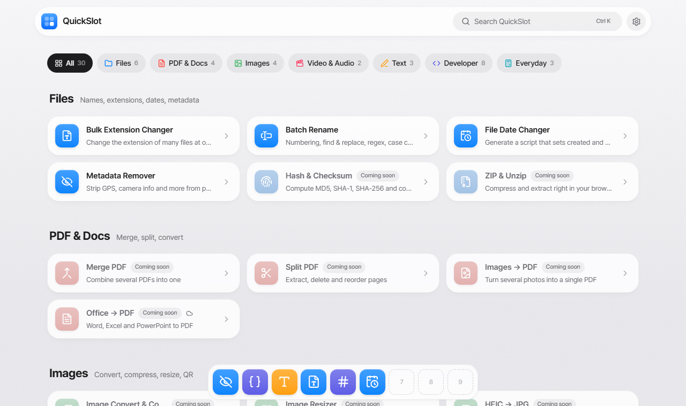

<div align="center">


# QuickSlot

**The tools you need, one click away in your browser.**

Everyday and developer utilities that run on your device.<br />
No install, no sign-up, and your files stay on your computer unless a tool clearly says otherwise.

[](https://github.com/wollu-dev/quick-slot/actions/workflows/ci.yml)
[](LICENSE)


**English** · [한국어](README.ko.md) · [日本語](README.ja.md)

<picture>
  <source media="(prefers-color-scheme: dark)" srcset="docs/assets/home-en-dark.png" />
  
</picture>

</div>

## Why QuickSlot?

Renaming a batch of files, stripping GPS data from a photo, pretty-printing JSON. Small jobs like these usually mean hunting for a sketchy website and uploading your files to someone else's server.

- **🔒 Private by design.** Tools run in your browser by default, so your files are processed on your device. The rare tool that needs a server is marked as such, and files sent to it are deleted right after processing.
- **⚡ Instant.** Nothing to install or sign up for. Open a tool and drop your files in.
- **⭐ Quick Slots.** Pin up to 9 favorite tools to a macOS-style dock and open them with <kbd>Alt</kbd>+<kbd>1</kbd>–<kbd>9</kbd>.
- **🔗 Your own tools.** Add any website you use often (for example an AI chat) as a tool. It shows up in search and the dock, and opens in a new tab after a short warning about uploads, licenses and privacy.
- **🌏 Multilingual.** Korean, English and Japanese, with light, dark and auto appearance.

## Tools

| Tool | What it does |
|---|---|
| **File Converter** | Actually convert images, audio, video and data files (JPG, PNG, WebP, AVIF, HEIC, MP3, MP4, WebM, JSON, YAML, CSV, XML and more) |
| **Batch Rename** | Numbering, find & replace, regex, case conversion |
| **File Date Changer** | Download files with new created and modified dates as a ZIP, or get a PowerShell / Bash script |
| **Metadata Remover** | Strip GPS, camera info and more from JPEG / PNG / WebP without losing quality |
| **Hash & Checksum** | MD5, SHA-1, SHA-256, SHA-512 and CRC32 of files or text, verify a published hash, and check whether files are identical |
| **Character Counter** | Characters with and without spaces, words, bytes, reading time |
| **Korean ↔ English Keyboard Fix** | Fix text typed in the wrong Korean / English mode (dkssud → 안녕, ㅗ디ㅣㅐ → hello) |
| **Text Diff** | Compare two texts by line, word or character, with changed words highlighted and a unified diff to copy |
| **JSON Formatter** | Pretty-print, minify, and pinpoint the exact line and column of errors |
| **Base64 Encode / Decode** | Text and files, URL-safe and data-URL output |
| **Unix Timestamp** | Convert timestamps ↔ dates with auto-detected units |
| **UUID Generator** | Generate UUID v4 / v7 in bulk |
| **Password Generator** | Random passwords with the length and characters you choose, plus a strength meter |
| **JWT Decoder** | Read a token's header and payload, with expiry status and readable times (signature not verified) |
| **Color Converter** | Pick or paste a color and copy it as HEX, RGB, HSL, Unity, Unreal (linear) or Godot code, with a WCAG contrast check |
| **Date Calculator** | Days between dates (D-day, weekdays), age, and adding days, weeks, months or weekdays to a date |
| **Unit Converter** | Length, weight, area (incl. pyeong), volume, temperature, speed and data size, all units at once |
| **Bill Splitter** | Split a bill evenly or with extras per person, round to 10 / 100 / 1000, and copy a summary to share |

<details>
<summary><b>Coming soon</b> (11 tools)</summary>

| Category | Tools |
|---|---|
| Files | ZIP & Unzip |
| PDF & Docs | Merge PDF · Split PDF · Images → PDF · Office → PDF |
| Images | Image Compressor · Image Resizer · QR Code |
| Video & Audio | Video → GIF · Screen Recorder |
| Developer | Normal Map Green Flip |

</details>

## Features

- **Spotlight-style search.** Press <kbd>Ctrl</kbd>+<kbd>K</kbd> (or <kbd>/</kbd>) to find any tool, even by its name in another language.
- **Quick Slot dock.** Place it at the bottom, left or right, in three sizes. The tool you're using is marked with a dot, just like a running app.
- **Settings sheet.** Appearance, dock position and size, and language, in one place. Applied before the first paint, so there's no flicker.
- **Language suggestions.** If your browser language differs from the page, QuickSlot offers to switch instead of redirecting you, so every language stays crawlable by search engines.
- **Safe file conversion.** The real format is read from the file content, not the extension. When the format already matches, the file is only renamed with no re-encoding, and combinations that can't be converted are refused instead of producing a mislabeled file. Audio and video use ffmpeg.wasm (about 30 MB, downloaded only the first time).
- **Lossless where it matters.** The metadata remover edits bytes directly instead of re-encoding, and keeps rotation and color profiles unless you say otherwise.

## Getting started

**Requirements:** Node.js 22.23 or later and npm.

```bash
git clone https://github.com/wollu-dev/quick-slot.git
cd quick-slot
npm install
npm run dev
```

Then open <http://localhost:4321>.

| Command | Description |
|---|---|
| `npm run dev` | Start the dev server at `localhost:4321` |
| `npm run build` | Build the static site into `apps/web/dist` |
| `npm run preview` | Serve the production build locally |
| `npm run check` | Type-check the whole project |

## Configuration

The site URL is never hard-coded. Set it where you build:

| Variable | Purpose | If unset |
|---|---|---|
| `SITE_URL` | Full site URL, e.g. `https://example.com`. Used for `hreflang` and `canonical` links | Relative URLs are used (fine for development) |

- **Locally:** copy `apps/web/.env.example` to `apps/web/.env` (git-ignored).
- **GitHub Actions:** add a repository **variable** named `SITE_URL`.
- **Docker:** pass `--build-arg SITE_URL=https://…`.

## Project structure

```
quick-slot/
├─ apps/web/                 # The website (Astro + React islands + Tailwind CSS)
│  ├─ src/
│  │  ├─ tools/registry.ts   # ★ Tool manifest that home, search and the dock all read from
│  │  ├─ tools/<category>/   # One React component per tool
│  │  ├─ i18n/               # Dictionaries: ko.ts (source of types), en.ts, ja.ts
│  │  ├─ views/              # Page templates shared by every language
│  │  ├─ pages/              # Routes: Korean at /…, English and Japanese at /[lang]/…
│  │  ├─ components/         # Search, settings sheet, dock, shared UI
│  │  ├─ lib/                # Files/ZIP, metadata stripping, slots, theme, dock settings
│  │  └─ styles/global.css   # Design tokens and the glass design system
│  └─ public/
├─ docs/assets/              # Screenshots for the README
└─ AGENTS.md                 # Contribution rules for humans and AI agents
```

## Adding a tool

1. Add an entry to `apps/web/src/tools/registry.ts`.
2. Add its name and description under `tools` in `apps/web/src/i18n/ko.ts`, `en.ts` and `ja.ts` (a missing key is a type error).
   With `status: 'soon'` you're done. A "coming soon" page is generated in all three languages.
3. Write the component in `apps/web/src/tools/<category>/MyTool.tsx`.
   Put every UI string in the dictionaries, read them with `useT()`, and export with `export default withI18n(MyTool)`.
4. Wire it up in the "Tool component wiring" block of `apps/web/src/views/ToolPage.astro`:
   ```astro
   {slug === 'my-tool' && <MyTool client:load lang={lang} />}
   ```
   Use `client:only="react"` if the first render depends on the current time, randomness or browser APIs.
5. Set the tool's `status` to `'ready'`.

## Internationalization

| Language | URL |
|---|---|
| 한국어 (Korean) | `/` |
| English | `/en/` |
| 日本語 (Japanese) | `/ja/` |

Every language is a separate static page with `hreflang` links. QuickSlot never redirects based on the browser language, because that would send search-engine crawlers (which mostly browse in English) away from the Korean and Japanese pages. Instead it shows a suggestion banner, and only redirects once the user has chosen a language.

## Deployment

The planned deployment is a Docker image published to the GitHub Container Registry and self-hosted. It isn't set up yet. For now, CI only type-checks and builds every pull request.

## Contributing

Contributions are welcome! This project follows GitHub Flow: branch from `main`, open a pull request, and squash-merge once CI passes.

Please read **[AGENTS.md](AGENTS.md)** first. It holds the rules for code, design, i18n, commits and pull requests, for humans and AI coding agents alike. ([한국어](AGENTS.ko.md) · [日本語](AGENTS.ja.md))

## License

[MIT](LICENSE) © 2026 Jaeyun Jung (WolLu)
